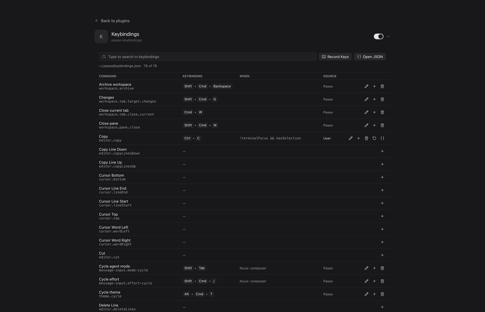
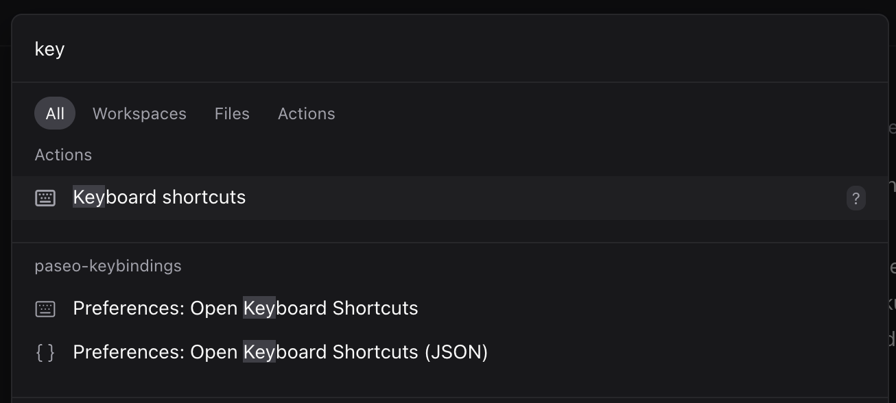

<p align="center"></p>

<h1 align="center">Keybindings</h1>

<p align="center">VS Code-style, focus-aware keyboard shortcuts for the Paseo desktop and web app.</p>



One `keybindings.json` of `{ key, command, when }` entries remaps both the plugin's commands (copy,
paste, cursor movement, terminal keys) and Paseo's own actions (workspaces, panes, tabs, composer).
A `when` clause lets the same key do different things in the terminal and in chat.

No bindings ship by default: until you add one, every key behaves as before.

## Install

Requires Paseo 0.17.3 or later, with plugins enabled (Settings → Plugins).

```bash
paseo plugin install github:lmgarret/paseo-keybindings
```

## Quick start

Open the Command Center (Cmd/Ctrl+K) and type `key`:



- **Preferences: Open Keyboard Shortcuts**: a searchable table of every command and Paseo
  shortcut. Click the pencil on a row, press the new key combination, then Enter.
- **Preferences: Open Keyboard Shortcuts (JSON)**: edit `~/.paseo/keybindings.json` directly, with
  validation and completion (Ctrl+Space).

Changes apply as soon as you save. No reload needed.

### Example: Ctrl+C copies in chat, interrupts in the terminal

Useful on macOS when a tool like Karabiner-Elements maps Cmd shortcuts to Ctrl but leaves raw
Ctrl+C to the terminal:

```json
[
  { "key": "ctrl+c", "command": "editor.copy", "when": "!terminalFocus && hasSelection" }
]
```

With text selected in chat, the composer, or agent output, Ctrl+C copies it. In a focused terminal
it still reaches the shell as SIGINT.

### Example: move a Paseo shortcut

As in VS Code, bind the new key and free the old one with a `-command` entry:

```json
[
  { "key": "cmd+d", "command": "workspace.pane.split.right" },
  { "key": "cmd+\\", "command": "-workspace.pane.split.right" }
]
```

## Documentation

- [Editing bindings](docs/editing.md): the Keyboard Shortcuts table and the JSON editor.
- [Reference](docs/reference.md): binding format, keys, `when` contexts, commands, Paseo actions,
  and precedence.
- [Limitations](docs/limitations.md): platforms, how the Paseo integration works, known gaps.
- [Development](docs/development.md): local install, tests, and source layout.

## License

[MIT](LICENSE)
