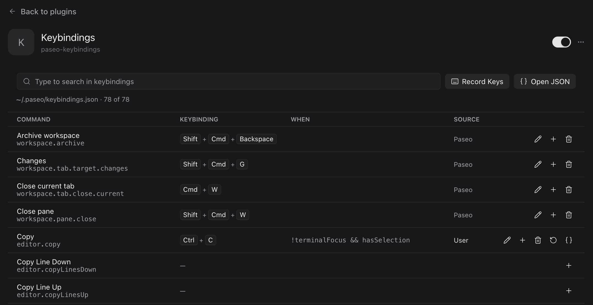
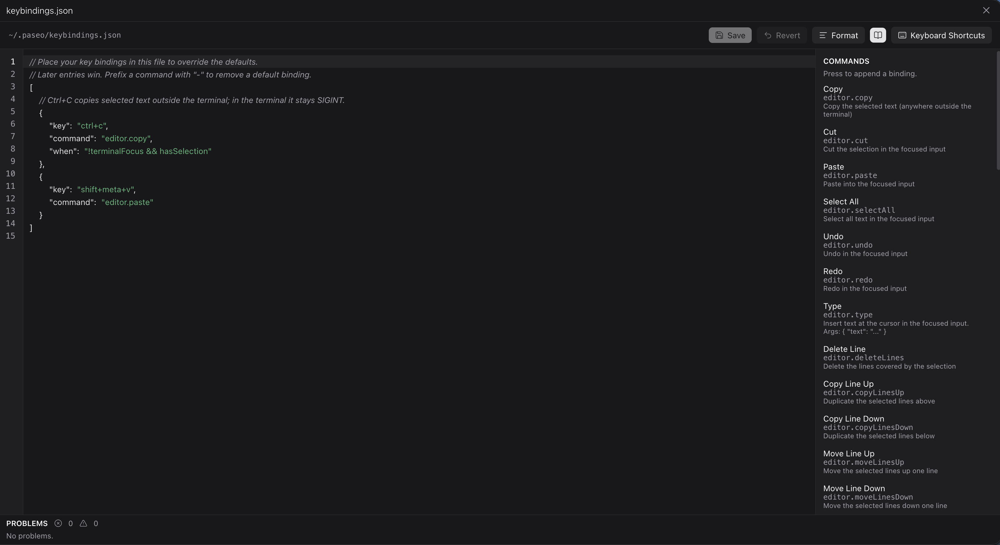

# Editing bindings

Your bindings live in `<paseo home>/keybindings.json` (`~/.paseo/keybindings.json` by default) on
the daemon host, layered after the code defaults in `client/defaults.ts` (empty). Changes apply
live, with no reload, whether they come from the UI or from another editor.

The file is JSON with comments and trailing commas. Entries with errors are skipped and the rest
still apply. See the [reference](reference.md) for the binding format.

Both screens open from the Command Center (Cmd/Ctrl+K).

## Keyboard Shortcuts table

**Preferences: Open Keyboard Shortcuts**, also under Settings → Plugins.

A table of every command with its keybinding, `when`, and source (Default, User, or Paseo).

- Search by text, or with **Record Keys** to find what a key combination does.
- Narrow a search to one column with `@source:user`, `@command:copy`, `@keybinding:ctrl+k`, or
  `@when:terminalFocus`. The User / Default / Paseo / Unbound toggles above the table add and remove
  `@source:` filters.
- Click a column header to sort by it; click again to reverse, a third time for the default order.
- User rows have an accent bar on the left.
- Each row can be changed, added, removed, reset, or shown in the JSON.
- A binding that shares its key names the others (**Also on this key: …**). Click the warning to list
  every binding on that key; clear the filter with the × in the search box.
- The binding dialog records keys (press the combination, then Enter), lists the bindings already on
  that key, and checks the `when` clause as you type.
- Editing a Default or Paseo row adds a user binding plus a `-command` entry that frees the old key.

**Paseo** rows are Paseo's shortcuts for your platform, with the rebinds saved in Paseo's
Settings → Shortcuts applied. Rows covering a digit range (jump to workspace 1–9) or a multi-stroke
key are read-only here. A binding on a Paseo key shows **Overrides Paseo: …**, and the Paseo row
**Overridden by …**; both are clickable like the other collision warnings.

In the desktop app, the table also lists the shortcuts of Paseo's desktop menu (zoom, reload, new
window, hide, quit, ...) as read-only Paseo rows. For keys the menu takes first (zoom, and on macOS
hide, quit, minimize, full screen), a binding shows **Never runs, Paseo's menu takes the key: …**,
and the menu row **Blocks …**. For the others, a binding overrides the menu item like any Paseo
shortcut. The key recorder turns the zoom keys off while it records, as Paseo's own shortcut
settings do.

## JSON editor

**Preferences: Open Keyboard Shortcuts (JSON)**, or **Open JSON** in the table.

- Syntax highlighting and line numbers.
- Problems list (syntax errors, invalid keys or `when` clauses, unknown commands or contexts) with
  jump-to-line.
- Completion for commands, contexts, and property names (Ctrl+Space).
- Tab/Shift+Tab indent, auto-indent, Cmd/Ctrl+/ comments, Shift+Alt+F format (keeps comments),
  Cmd/Ctrl+S save.
- A commands/contexts reference that appends bindings.

Saves are compare-and-swap: if the file changed on disk, you choose which version to keep.
